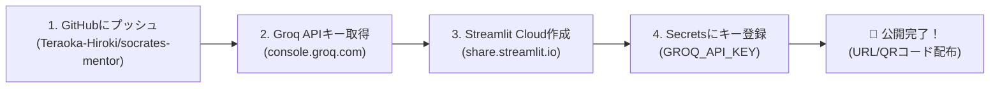

# ソクラテス・メンター 〜正解を教えない壁打ちチャット〜

> **「自分が価値を置くものに向かって こつこつ努力する姿ほど 素晴らしいものはない」**  
> — テラオカ電子の自由探究ゼミ


%20%2B%20Local-purple)

---

## 📖 1. アプリ概要と教育的ねらい

### 💡 開発の背景と目的
現代の高校生は、総合的な探究の時間、総合型選抜・推薦入試の志望理由書作成、プログラミング学習など、**「正解のない問い」**に向き合う機会が急速に増えています。
しかし、一般的な生成AI（ChatGPT等）に相談すると、AIは親切に「模範解答」や「要約」を与えてしまいます。その結果、生徒は**「わかった気」になって思考を停止**してしまい、自らの頭で粘り強く考え抜く力やメタ認知が育ちにくくなるという教育的課題が生じています。

**「ソクラテス・メンター」**は、古代ギリシャの哲学者ソクラテスの「産婆術（問答法）」を現代の最新LLM技術で再現した探究学習支援アプリです。
- **絶対に答え・解決策・アドバイスを教えません。**
- 生徒の入力した言葉（キーワード）を鏡のように反射し、**「思考を深めるための短く鋭い問い」**だけを温かく返します。
- 高校生が自分のモヤモヤした思考を打ち込むことで、**「言語化（外化）」「前提の検証」「メタ認知の活性化」**を促します。

---

## ✨ 2. 主要機能一覧

| 機能 | 内容・特徴 |
| :--- | :--- |
| 💬 **ソクラテス・壁打ちチャット** | 答えを教えず、高校生の言葉に寄り添いながら1つの鋭い問いを返します。新しい会話が上に積み上がる直感レイアウト。 |
| 🤖 **多彩なLLMモデル対応** | **Meta Llama 3.3 (70B)**、**Google Gemma 2 (9B)**、**Mixtral (8x7B)**、超高速 **Llama 3.1 (8B)**、外部通信不要の **ローカルLLM (Qwen2.5)** に完全対応。 |
| 🎙️ **音声入力対応（Web Speech API）** | マイクで話した音声をリアルタイム文字起こし。「🚀 テキストを入力欄に転送」ボタンでチャット欄へ自動転送。 |
| 🧠 **AIによる対話の論点整理＆知見自律生成** | カレンダー保存時、LLMが対話履歴全体を読み込み、「探究テーマ」「対話の展開」「得られた知見」「次の問い」を文章として自律生成。 |
| 📅 **探究カレンダー＆記録** | 日付ごとに対話テーマや概要、AIが生成した知見まとめを蓄積。過去ログの閲覧・復元にも対応。 |
| 🔥 **学習継続ストリーク** | 毎日の学習継続日数をカウント。継続的な探究習慣を後押しします。 |
| 📥 **対話ログのダウンロード** | ワンクリックで対話履歴とAI知見まとめ、振り返り欄を含む構造化テキスト（`.txt`）を出力。 |
| 🔬 **LLMの学術的解説** | 高校生向けにTransformer（Self-Attention機構）や次トークン予測の数理を論理的かつ正確に解説。 |
| 💡 **思考深化の認知科学解説** | なぜ対話で思考が深まるのか、探究テーマ・志望理由・プログラミングの3つの事例で解説。 |
| 🛡️ **セキュア＆プライバシー保護** | 外部サーバーに対話ログを保存しないステートレス設計。Streamlit Cloud Secrets連携でAPIキーを完全秘匿。 |
| 🎨 **クールなダークモード** | スレートネイビーとサイバーシアンのアクセントで、長時間でも目が疲れないスタイリッシュUI。 |
| 🏷️ **指定ロゴの完全再現** | 「テラオカ電子の自由探究ゼミ」プロフィール・ロゴをタイトル右側に美しく水平配置。 |

---

## 🤖 3. 対応LLMモデル詳細

本アプリは、クラウドの超高速LPU（Groq）と、PC内ローカル実機推論の双方に対応しています。

| モデル名 | 提供元 | パラメータ | 特徴・用途 |
| :--- | :--- | :--- | :--- |
| **`llama-3.3-70b-versatile`** *(推奨)* | Meta | 70B (700億) | **最高峰の論理的思考力**。探究学習の複雑な文脈を正確に理解し、核心を突く深い問いかけを行います。コンテキスト長128k。 |
| **`llama-3.1-8b-instant`** | Meta | 8B (80億) | **超高速レスポンス**。待ち時間ほぼゼロでテンポよく壁打ちラリーを続けたい場合に最適。 |
| **`gemma2-9b-it`** | Google DeepMind | 9B (90億) | **高知能オープンモデル**。Google独自のアーキテクチャによる高い日本語表現力と自然な対話が特徴。 |
| **`mixtral-8x7b-32768`** | Mistral AI | 47B (MoE) | **多角的視点・長文対応**。Mixture of Experts技術により、多様な観点からの問いかけと32kの長文コンテキストに対応。 |
| **`Qwen2.5-0.5B-Instruct`** *(ローカル)* | Alibaba / 本機 | 0.5B (5億) | **PC内実機完全オフライン稼働**。外部通信を行わず、PC内部のCPUでニューラルネットワークを直接計算。プライバシー完全隔離。 |

---

## 🏗️ 4. 実行形態（ハイブリッド提供）

### ①【要件定義書準拠・デプロイ用】Streamlit版 (`app.py`)
- **特徴:** Python環境で動作し、Streamlit Community Cloudへワンクリックで無料デプロイ可能。
- **機能:** SecretsによるAPIキー秘匿化、全モデル切り替え、音声転送、AI知見要約、カレンダー保存、テキストDL。
- **技術スタック:** Python 3.10+, Streamlit, Groq REST API, PyTorch / Transformers (ローカル推論対応)

### ②【インストール不要】完全フロントエンドSPA版 (`index.html`)
- **特徴:** サーバー不要。ブラウザ（Chrome / Edge等）でファイルをダブルクリックするだけで即座に稼働。
- **技術スタック:** HTML5, Tailwind CSS, JavaScript (ES6+), Web Speech API, LocalStorage

---

## 🌐 5. Streamlit Community Cloudへの無料デプロイ手順

本アプリは、**Streamlit Community Cloud** を使用して世界中の生徒（スマホ・Chromebook等）へ無料で公開できます。



### ステップ 1: GitHubへのプッシュ
1. GitHub上にリポジトリ `socrates-mentor` を作成し、本フォルダのファイルをプッシュします：
   ```powershell
   git remote add origin https://github.com/Teraoka-Hiroki/socrates-mentor.git
   git branch -M main
   git push -u origin main
   ```

### ステップ 2: Groq APIキーの無料取得（約2分）
1. [Groq Cloud Console](https://console.groq.com/keys) にアクセスし、無料アカウントを作成（クレジットカード不要）。
2. **「API Keys」** > **「Create API Key」** をクリックし、発行されたキー（`gsk_...`）をコピーします。

### ステップ 3: Streamlit Community Cloudでアプリ作成
1. [Streamlit Community Cloud](https://share.streamlit.io/) にGitHubアカウントでログインします。
2. **「Create app」** をクリックし、以下を入力します：
   - **Repository:** `Teraoka-Hiroki/socrates-mentor`
   - **Branch:** `main`
   - **Main file path:** `app.py`

### ステップ 4: Secrets（環境変数）にAPIキーを登録
1. デプロイ画面の **「Advanced settings」** を開き、**「Secrets」** に以下を貼り付けます：
   ```toml
   GROQ_API_KEY = "gsk_あなたのGroq_APIキー"
   ```
2. **「Save」** を押して **「Deploy!」** をクリックします。
3. 約1分でビルドが完了し、公開URL（例: `https://socrates-mentor.streamlit.app`）が発行されます。

---

## 💻 6. ローカル環境での起動方法

### Streamlit版のローカル起動:
```powershell
# 依存ライブラリのインストール
pip install -r requirements.txt

# アプリ起動
streamlit run app.py
```
ブラウザで `http://localhost:8501` が自動で開きます。

### 完全フロントエンド版の起動:
`index.html` をダブルクリックしてブラウザで開くか、または簡易サーバーで実行します：
```powershell
python -m http.server 8000
```
`http://localhost:8000` で即座に利用できます。

---

## 🔬 7. 大規模言語モデル（LLM）のアルゴリズム解説

高校生がAIをブラックボックスとして盲信するのではなく、情報科学の視点から原理を正しく理解できるように解説を内蔵しています。

### ① 次トークン予測（Next Token Prediction）の原理
LLMは数式に基づく**「確率統計的な単語予測モデル」**です。文章をトークン（単語や文字の断片）に分割し、文脈 $x_1, \dots, x_t$ が与えられたとき、次に来るトークン $x_{t+1}$ の条件付き確率分布 $P(x_{t+1} \mid x_1, \dots, x_t)$ を計算し、最も自然な言葉をサンプリングして出力します。

### ② TransformerとSelf-Attention機構
2017年のGoogle論文「Attention Is All You Need」で登場したTransformerの中核は**Self-Attention（自己注意機構）**です。
すべての単語ペアについて、Query（照会）、Key（適合）、Value（意味内容）の3つのベクトルを行列計算します：

$$\text{Attention}(Q, K, V) = \text{softmax}\left(\frac{QK^T}{\sqrt{d_k}}\right)V$$

これにより、「彼」「それ」などの指示語が文中のどの単語と結びついているのか、長距離の依存関係を一括で並列計算できます。

### ③ トークン数確保と途切れ防止制御（要件⑩）
本アプリでは `max_tokens: 3072` を確保し、ソクラテスの問いかけや知見まとめが途中で途切れることなく、まとまりのある完結した日本語の文章で終了するように厳密に制御されています。

---

## 🧠 8. 「壁打ち対話」で思考が深まる理由（認知科学）

### なぜ「答え」を与えられると頭が悪くなるのか？
人間の脳はエネルギー消費を抑える性質（**認知の怠惰：Cognitive Miser**）を持っています。AIから「正解」を与えられると脳は思考を止めますが、自分の頭で悩み、言葉を絞り出すプロセスを経ることで、初めて神経回路（シナプス）が強化されます。

### 壁打ち対話の3大効用
1. **外化（Externalization）:** 頭の中のモヤモヤした感覚を言語として文字化することで、自分の思考を客観視できる。
2. **メタ認知の起動:** 「なぜそう言えるのか？」「前提は何か？」と問われることで、思考の偏りや論理の飛躍に自ら気づく。
3. **構成主義的学習:** 自らの試行錯誤を通じて掴み取った洞察は、表面的な暗記と異なり、一生モノの真の教養となる。

---

## 📂 9. ディレクトリ構成

```text
ソクラテス/
├── app.py                     # 【メイン】Streamlit版アプリケーション本体
├── index.html                 # 【SPA版】完全フロントエンドWebアプリケーション
├── requirements.txt           # Pythonライブラリ依存関係 (streamlit, groq, python-dotenv)
├── .streamlit/
│   └── config.toml            # Streamlitダークモードテーマ設定
├── .gitignore                 # Git除外設定（キャッシュ・機密情報を保護）
├── teraoka.png                # テラオカ電子ロゴ画像（右上プロフィール用）
├── static/
│   └── teraoka.png            # 静的アセット用ロゴ画像
├── 要件定義書.md              # プロジェクト初期の要件定義書
└── README.md                  # 本ドキュメント（完全仕様解説マニュアル）
```

---

## 📜 10. ライセンスと著作権表示

```text
2026 Teraoka-Denshi. All rights reserved.
テラオカ電子の自由探究ゼミ 探究学習支援プロジェクト
```
