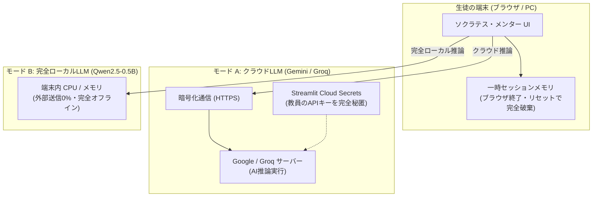

# ソクラテス・メンター 〜正解を教えない壁打ちチャット〜

> **「自分が価値を置くものに向かって こつこつ努力する姿ほど 素晴らしいものはない」**  
> — テラオカ電子の自由探究ゼミ


---

## 📖 1. アプリ概要と教育的ねらい

### 💡 開発の背景と目的
現代の高校生は、総合的な探究の時間、総合型選抜・推薦入試の志望理由書作成、情報科のプログラミング学習など、**「正解のない問い」**に向き合う機会が急速に増えています。
しかし、一般的な生成AI（ChatGPT等）に相談すると、AIは親切に「模範解答」や「要約」を与えてしまいます。その結果、生徒は**「わかった気」になって思考を停止**してしまい、自らの頭で粘り強く考え抜く力やメタ認知が育ちにくくなるという教育的課題が生じています。

**「ソクラテス・メンター」**は、古代ギリシャの哲学者ソクラテスの「産婆術（問答法）」を現代の最新LLM技術で再現した探究学習支援アプリです。
- **絶対に答え・解決策・アドバイスを教えません。**
- 生徒の入力した言葉（キーワード）を鏡のように反射し、**「思考を深めるための短く鋭い問い」**だけを温かく返します。
- 高校生が自分のモヤモヤした思考を打ち込むことで、**「言語化（外化）」「前提の検証」「メタ認知の活性化」**を促します。

---

## ✨ 2. 主要機能一覧

| 機能 | 内容・特徴 |
| :--- | :--- |
| 💬 **ソクラテス・壁打ちチャット** | 答えを教えず、高校生の言葉に寄り添いながら1つの鋭い問いを返します。新しい会話が上に積み上がる直感レイアウト。 |
| 🤖 **ハイブリッドLLM対応** | **Google Gemini (1.5 Flash / 2.0 Flash / Pro)**、**Groq Cloud (Llama 3.3 / Gemma 2)**、および外部通信ゼロの **PC内蔵ローカルLLM (Qwen2.5)** に完全対応。 |
| 🔄 **動的モデル自動検出 (ListModels)** | Google Generative Language APIから利用可能なモデルを自動取得し、404エラーを防止して常に最適なモデルへ接続。 |
| 🎙️ **音声入力対応（Web Speech API）** | マイクで話した音声をリアルタイム文字起こし。「🚀 テキストを入力欄に転送」ボタンでチャット欄へ自動転送。 |
| 🧠 **AIによる対話の論点整理＆知見自律生成** | カレンダー保存時、LLMが対話履歴全体を読み込み、「探究テーマ」「対話の展開」「得られた知見」「次の問い」を文章として自律生成。 |
| 📅 **探究カレンダー＆記録** | 日本時間 (JST) で正確に日付・時刻を記録。日付ごとに対話テーマや概要、AI知見まとめを蓄積。 |
| 📦 **探究ポートフォリオの保存・復元** | カレンダー全記録・知見・ストリークをJSONファイルとして保存。次回アクセス時に読み込むだけで100%完全再現。 |
| 🔥 **学習継続ストリーク自動計算** | カレンダーログから実際の継続日数を自動算出。継続的な探究習慣を後押しします。 |
| 📥 **対話ログのダウンロード** | ワンクリックで対話履歴とAI知見まとめ、振り返り欄を含む構造化テキスト（`.txt`）を出力。 |
| 🔬 **LLMの学術的解説** | 高校生向けにTransformer（Self-Attention機構）や次トークン予測の数理を論理的かつ正確に解説。 |
| 💡 **思考深化の認知科学解説** | なぜ対話で思考が深まるのか、探究テーマ・志望理由・プログラミングの3つの事例で解説。 |
| 🛡️ **セキュリティ・プライバシー保護** | 外部DBを持たないステートレス設計。Secrets連携によるAPIキー完全秘匿と生徒向けガイドラインを内蔵。 |
| 🎨 **クールなダークモード** | スレートネイビーとサイバーシアンのアクセントで、長時間でも目が疲れないスタイリッシュUI。 |
| 🏷️ **指定ロゴの完全再現** | 「テラオカ電子の自由探究ゼミ」プロフィール・ロゴをタイトル右側に美しく水平配置。 |

---

## 🛡️ 3. セキュリティとプライバシー設計（ローカル vs クラウド）

学校現場や教育現場で安全にご利用いただくため、本アプリはセキュリティ仕様を明確に定義しています。



### ① クラウドLLM（Google Gemini / Groq）利用時【推奨】
* **APIキーの秘匿化:** 教員が登録した API キーは Streamlit Cloud の `Secrets` 領域で暗号化管理され、生徒側の画面やコードには一切露出しません。
* **ステートレス（DB非保持）設計:** 独自の外部保存データベースを一切持たないため、生徒の対話が外部サーバーに蓄積・漏洩する心配はありません。
* **⚠️ 【生徒向け重要注意事項】個人情報の非入力:**
  AI推論のため、暗号化通信（HTTPS）を通じて外部クラウドと通信します。Google AI Studio（無料枠API）等の利用規約をふまえ、**「氏名・学校名・住所・電話番号、友人の個人名」などの個人情報は絶対に入力しないよう生徒にご指導ください。**

### ② ローカルLLM（Qwen2.5-0.5B）利用時【真の完全ローカル仕様】
* **外部通信 0%（完全遮断）:** インターネット通信を一切行わず、PC内部のCPU・メモリ上だけで直接ニューラルネットワーク推論を実行します。
* **オフライン稼働:** ネットが繋がっていない環境でも動作し、入力したテキストは1文字たりとも端末の外に出ません。教育委員会等の厳しいセキュリティ制限下でも安心です。

---

## 🤖 4. 対応LLMモデル詳細

| モデル名 | 提供元 | 特徴・用途 | 無料枠の目安 |
| :--- | :--- | :--- | :--- |
| **`gemini-1.5-flash`** *(推奨)* | Google | **超高速・高精度・大容量**。高校生の壁打ちに最もバランスが良く、安定した日本語を生成。 | 15 RPM / 1,500 RPD |
| **`gemini-2.0-flash`** | Google | **次世代の最新高速モデル**。高度な文脈理解と最新の論理的思考力を提供。 | 10 RPM / 1,500 RPD |
| **`gemini-1.5-flash-8b`** | Google | **超軽量・超低遅延**。短い壁打ちラリーを素早く繰り返したい場合に最適。 | 15 RPM / 1,500 RPD |
| **`gemini-1.5-pro`** | Google | **最深思考・最高精度**。長大な文章の分析や、深い自己分析・小論文の深掘りに威力を発揮。 | 2 RPM / 50 RPD |
| **`llama-3.3-70b-versatile`** | Meta (Groq) | **最高峰の700億パラメータ**。超高速LPUによる圧倒的な推論速度と深い洞察力。 | 30 RPM |
| **`gemma2-9b-it`** | Google (Groq) | **高知能オープンモデル**。Google独自の高知能アーキテクチャによる自然な日本語対話。 | 30 RPM |
| **`Qwen2.5-0.5B`** *(ローカル)* | Alibaba / 本機 | **完全オフライン実機推論**。外部通信なしでPC内部で完結するセキュア推論。 | 無制限（実機スペック依存） |

---

## 🌐 5. Streamlit Community Cloudへの無料デプロイ手順

本アプリは、**Streamlit Community Cloud** を使用して世界中の生徒（スマホ・Chromebook等）へ完全無料で公開できます。

### ステップ 1: GitHub へのプッシュ
リポジトリ（`Teraoka-Hiroki/socrates-mentor`）へ本フォルダのファイルをプッシュします：
```powershell
git add .
git commit -m "Update app"
git push origin main
```

### ステップ 2: APIキーの無料取得（Google AI Studio または Groq）
* **Google Gemini API の場合（推奨・約1分）:**
  1. [Google AI Studio](https://aistudio.google.com/app/apikey) にGoogleアカウントでログイン。
  2. **「Get API key」** > **「Create API key」** をクリックしてキー（`AIzaSy...`）を取得。
* **Groq の場合（約2分）:**
  1. [Groq Cloud Console](https://console.groq.com/keys) にサインイン。
  2. **「Create API Key」** からキー（`gsk_...`）を発行。

### ステップ 3: Streamlit Community CloudでSecretsを設定
1. [Streamlit Community Cloud](https://share.streamlit.io/) でアプリの設定画面（**「App settings」** > **「Secrets」**）を開きます。
2. 以下のように取得したキーを貼り付けて保存します：
   ```toml
   # Google Gemini APIキー（推奨）
   GEMINI_API_KEY = "AIzaSy..."

   # または Groq APIキー
   GROQ_API_KEY = "gsk_..."
   ```
   ※ アプリ側で自動判別するため、どちらか片方（または両方）を記入すれば自動で最適化されます。
3. アプリが自動再起動し、世界中から安全にアクセス可能になります。

---

## 💻 6. ローカル環境での起動方法

```powershell
# 依存ライブラリのインストール
pip install -r requirements.txt

# アプリ起動
streamlit run app.py
```
ブラウザで `http://localhost:8501` が自動で開きます。

---

## 🔬 7. 大規模言語モデル（LLM）のアルゴリズム解説

### ① 次トークン予測（Next Token Prediction）の原理
LLMは数式に基づく**「確率統計的な単語予測モデル」**です。文章をトークン（単語や文字の断片）に分割し、文脈 $x_1, \dots, x_t$ が与えられたとき、次に来るトークン $x_{t+1}$ の条件付き確率分布 $P(x_{t+1} \mid x_1, \dots, x_t)$ を計算し、最も自然な言葉をサンプリングして出力します。

### ② TransformerとSelf-Attention機構
2017年のGoogle論文「Attention Is All You Need」で登場したTransformerの中核は**Self-Attention（自己注意機構）**です。
すべての単語ペアについて、Query（照会）、Key（適合）、Value（意味内容）の3つのベクトルを行列計算します：

$$\text{Attention}(Q, K, V) = \text{softmax}\left(\frac{QK^T}{\sqrt{d_k}}\right)V$$

これにより、「彼」「それ」などの指示語が文中のどの単語と結びついているのか、長距離の依存関係を一括で並列計算できます。

---

## 📂 8. ディレクトリ構成

```text
ソクラテス/
├── app.py                     # 【メイン】Streamlit版アプリケーション本体
├── index.html                 # 【SPA版】完全フロントエンドWebアプリケーション
├── requirements.txt           # Pythonライブラリ依存関係 (streamlit, groq, python-dotenv)
├── .streamlit/
│   └── config.toml            # Streamlitダークモードテーマ設定
├── .gitignore                 # Git除外設定（キャッシュ・機密情報を保護）
├── teraoka.png                # テラオカ電子ロゴ画像（右上プロフィール用）
├── static/
│   └── teraoka.png            # 静的アセット用ロゴ画像
├── 要件定義書.md              # プロジェクト初期の要件定義書
└── README.md                  # 本ドキュメント（完全仕様解説マニュアル）
```

---

## 📜 9. ライセンスと著作権表示

```text
2026 Teraoka-Denshi. All rights reserved.
テラオカ電子の自由探究ゼミ 探究学習支援プロジェクト
```
